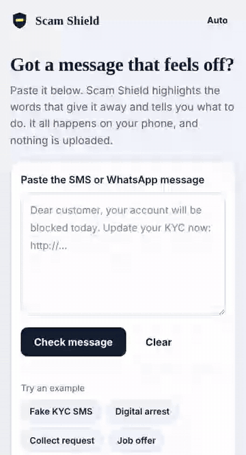
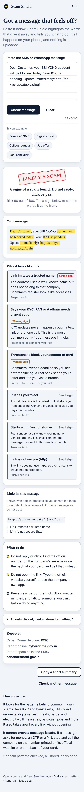
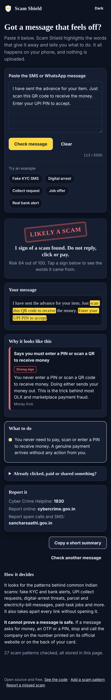
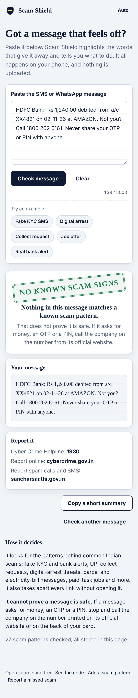

# Scam Shield

**Paste a suspicious SMS or WhatsApp message. See exactly which words give it away.**

Your phone does the checking. Nothing is uploaded, there is no account, and it works offline.

[](https://github.com/jay-m007/Scam-Shield/actions/workflows/pages.yml)


### [Try it now: jay-m007.github.io/Scam-Shield](https://jay-m007.github.io/Scam-Shield/)

<p align="center"></p>

## Why

Every week someone in your family gets a message like *"Your KYC is pending, your account will be blocked today"*. Most checkers just say "scam" or "not scam". That teaches nothing, and people stop trusting it the first time it is wrong.

Scam Shield shows its work:

- **It highlights the exact words** that triggered each warning, like a teacher marking a paper.
- **It explains the trick** in plain language, so people learn to spot the next one on their own.
- **It takes links apart without opening them**: look-alike bank names, raw IP addresses, `.apk` downloads, shortened links, hidden `@` tricks. Links are shown with `[.]` so nobody taps one by accident.
- **It tells you what to do next**, including the helpline and what to do if you already paid.

## What it catches

Fake KYC and bank-block alerts · OTP, PIN and card-detail requests · UPI collect and "scan to receive money" tricks · **digital arrest** and fake police, CBI, customs and TRAI calls · parcel and courier scams · electricity-disconnection threats · fake e-challans · paid-task and part-time job scams · stock-tip and guaranteed-return schemes · instant-loan and advance-fee lures · remote-access apps (AnyDesk and friends) · malicious `.apk` links · refund and "sent by mistake" tricks · "Hi Mum, new number" messages · gift-card requests · sextortion threats. It also reads Hinglish and some Hindi.

27 patterns today. They live in [`rules/`](rules/), one small file each.

## You can make it smarter in two minutes

New scams appear every week, and no single person sees them all. So the rules are open: **one scam pattern is one JSON file, and CI checks it against its own examples.**

```json
{
  "id": "upi-collect",
  "title": "Says you must enter a PIN or scan a QR to receive money",
  "category": "money",
  "weight": 45,
  "why": "You never enter a PIN or scan a QR code to receive money. Doing either sends your money out.",
  "patterns": ["\\benter\\s+(?:your\\s+)?(?:upi\\s+)?pin\\s+(?:to|and)\\s+(?:receive|get|claim)\\b"],
  "examples": ["Approve the collect request and enter your UPI PIN to receive the advance."],
  "safe": ["Scan this QR code to pay Ravi Kumar Rs 500."]
}
```

Every rule must list scam messages it **catches** and genuine messages it **leaves alone**. The tests run both, so a new rule cannot quietly start flagging real bank alerts. Read [CONTRIBUTING.md](CONTRIBUTING.md), or run `npm run check-rule rules/your-rule.json` to try one.

Got a scam that slipped through? [Report a missed scam](../../issues/new/choose) and a rule can be added.

## How it decides

Each rule has a weight. Signs add up with diminishing returns: `risk = 100 × (1 − ∏(1 − weight/70))`. At 45 or more it says **Likely a scam**, from 20 it says **Be careful**, and below that **No known scam signs**. Links add their own signs. Negated warnings are understood, so *"Do not share your OTP with anyone"* from a real bank is not treated as a request for your OTP.

There is no AI model and no network call, so the result is the same every time and you can see why.

## Run it yourself

```bash
git clone https://github.com/jay-m007/Scam-Shield
cd Scam-Shield
npm test          # 52 tests: engine, every rule, links, a corpus of scam and genuine messages
npm run serve     # builds, then open http://localhost:8080
```

No dependencies to install. Plain JavaScript modules, HTML and CSS.

## Privacy and safety

- The message never leaves the page. The Content Security Policy blocks every network request except loading this site's own files.
- Nothing is stored. Only your light/dark choice is saved.
- A pasted message is only ever inserted as text, never as HTML, so a hostile message cannot run code (checked in the browser tests).
- Rules are tested against pathological input so no rule can hang the page.

## Limits, stated honestly

- **It can miss scams.** It knows patterns, not the whole internet. "No known scam signs" never means "safe". If a message asks for money, an OTP or a PIN, call the company on the number from its official website.
- **It can raise false alarms**, for example a genuine HR email that asks for your PAN card. Report those so rules can be tightened.
- It reads English, Hinglish and some Hindi. More languages are welcome.
- It does not check a link against a live list of bad sites, because that would mean sending your link somewhere.
- It cannot check phone calls, only text you paste.

## If you were scammed

Call **1930** (National Cyber Crime Helpline) at once and report on [cybercrime.gov.in](https://cybercrime.gov.in). Money reported quickly can sometimes be frozen. Report spam calls and SMS at [sancharsaathi.gov.in](https://sancharsaathi.gov.in).

## Screenshots

<p align="center">
  
  
  
</p>

## License

MIT. Built by [Jay Maurya](https://github.com/jay-m007).
